

<!--
  Mohamed Amine El Khattabi — GitHub profile
  Every panel is a hand-built SVG in ./assets, with a light-theme twin in ./assets/light
-->

<a href="https://medamineelkhattabi.me"><picture><source media="(prefers-color-scheme: light)" srcset="assets/light/hero.svg"></picture></a>

<a href="#profile"><picture><source media="(prefers-color-scheme: light)" srcset="assets/light/nav-01.svg"></picture></a><a href="#expertise"><picture><source media="(prefers-color-scheme: light)" srcset="assets/light/nav-02.svg"></picture></a><a href="#work"><picture><source media="(prefers-color-scheme: light)" srcset="assets/light/nav-03.svg"></picture></a><a href="#activity"><picture><source media="(prefers-color-scheme: light)" srcset="assets/light/nav-04.svg"></picture></a><a href="#contact"><picture><source media="(prefers-color-scheme: light)" srcset="assets/light/nav-05.svg"></picture></a>

<picture><source media="(prefers-color-scheme: light)" srcset="assets/light/marquee.svg"></picture>

<picture><source media="(prefers-color-scheme: light)" srcset="assets/light/section-01.svg"></picture>

<picture><source media="(prefers-color-scheme: light)" srcset="assets/light/profile.svg"></picture>

 

<picture><source media="(prefers-color-scheme: light)" srcset="assets/light/section-02.svg"></picture>

<picture><source media="(prefers-color-scheme: light)" srcset="assets/light/expertise.svg"></picture>

 

<picture><source media="(prefers-color-scheme: light)" srcset="assets/light/section-03.svg">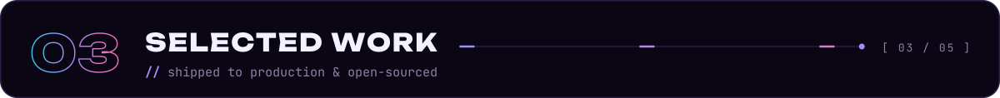</picture>

<a href="https://medamineelkhattabi.me"><picture><source media="(prefers-color-scheme: light)" srcset="assets/light/card-tanger-med.svg"></picture></a>

<a href="https://medamineelkhattabi.me"><picture><source media="(prefers-color-scheme: light)" srcset="assets/light/card-nexthire.svg"></picture></a>

<a href="https://github.com/Medamineelkhattabi/typely"><picture><source media="(prefers-color-scheme: light)" srcset="assets/light/card-typely.svg"></picture></a>

<picture><source media="(prefers-color-scheme: light)" srcset="assets/light/open-case.svg"></picture>

<picture><source media="(prefers-color-scheme: light)" srcset="assets/light/arch-typely.svg"></picture>

<a href="https://github.com/Medamineelkhattabi/semantic-rag"><picture><source media="(prefers-color-scheme: light)" srcset="assets/light/card-semantic-rag.svg"></picture></a>

<picture><source media="(prefers-color-scheme: light)" srcset="assets/light/open-case.svg"></picture>

<picture><source media="(prefers-color-scheme: light)" srcset="assets/light/arch-semantic-rag.svg"></picture>

<a href="https://github.com/Medamineelkhattabi/Real-time-object-detection"><picture><source media="(prefers-color-scheme: light)" srcset="assets/light/card-object-detection.svg"></picture></a>

<picture><source media="(prefers-color-scheme: light)" srcset="assets/light/open-case.svg"></picture>

<picture><source media="(prefers-color-scheme: light)" srcset="assets/light/arch-object-detection.svg"></picture>

<a href="https://github.com/Medamineelkhattabi/Smart-Mobility-Platform"><picture><source media="(prefers-color-scheme: light)" srcset="assets/light/card-smart-mobility.svg"></picture></a>

<picture><source media="(prefers-color-scheme: light)" srcset="assets/light/open-case.svg"></picture>

<picture><source media="(prefers-color-scheme: light)" srcset="assets/light/arch-smart-mobility.svg"></picture>

 

<picture><source media="(prefers-color-scheme: light)" srcset="assets/light/section-04.svg">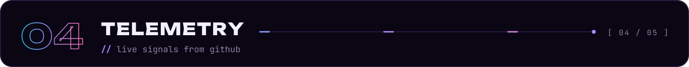</picture>

<picture><source media="(prefers-color-scheme: light)" srcset="assets/light/stats.svg"></picture>

<picture><source media="(prefers-color-scheme: light)" srcset="assets/light/heatmap.svg"></picture>

 

<picture><source media="(prefers-color-scheme: light)" srcset="assets/light/section-05.svg"></picture>

<picture><source media="(prefers-color-scheme: light)" srcset="assets/light/contact.svg"></picture>

<a href="https://medamineelkhattabi.me"><picture><source media="(prefers-color-scheme: light)" srcset="assets/light/btn-portfolio.svg">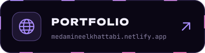</picture></a><a href="https://www.linkedin.com/in/mohamed-amine-el-khattabi-b09ab0212/"><picture><source media="(prefers-color-scheme: light)" srcset="assets/light/btn-linkedin.svg">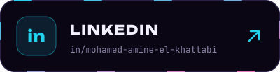</picture></a><a href="mailto:Medamine4elkhattabi@gmail.com"><picture><source media="(prefers-color-scheme: light)" srcset="assets/light/btn-email.svg"></picture></a>

<a href="#top"><picture><source media="(prefers-color-scheme: light)" srcset="assets/light/footer.svg"></picture></a>

